<!-- Deep-dive ocean theme. SVGs in assets/ocean/ are generated: edit scripts/build_ocean_svgs.py, then run `python scripts/build_ocean_svgs.py`. -->
<!-- Palette: sky #0B1F33 · surface #0F4C75 · twilight #0B3558 · midnight #082640 · abyss #04121F · aqua #5EEAD4 · coral #FF9B85 -->

  

  
  
  

  

  

  
  
  
  

  

  <!-- Built by .github/workflows/MAIN.yml and published to the `output` branch -->
  
  

  

