<!-- X-ray / DICOM theme. SVGs in assets/xray/ are generated: edit scripts/build_svgs.py, then run `python scripts/build_svgs.py`. -->
<!-- Palette: film #0A0F14 · panel #0F161D · line #1D2A33 · text #D8E6EE · muted #7F98A6 · amber #FFB000 -->

  

  <a href="http://www.linkedin.com/in/phatbtt-flynn-ai"></a>
  <a href="https://flynnbui399.github.io/FlynnBui399/"></a>
  

 


  

  


  <a href="https://github.com/FlynnBui399/vidruglens-ocr-vlm"></a>
  <a href="https://github.com/FlynnBui399/skin-lession-classification-using-fusion-ham10000"></a>
  <a href="https://github.com/FlynnBui399/DL-Research-Segmentation"></a>
  <a href="https://github.com/FlynnBui399/vietnamese-emoji-emotion-recognition"></a>


  
  

  

  

