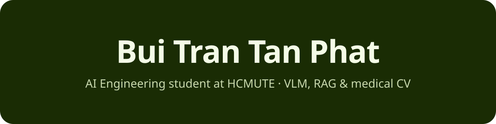
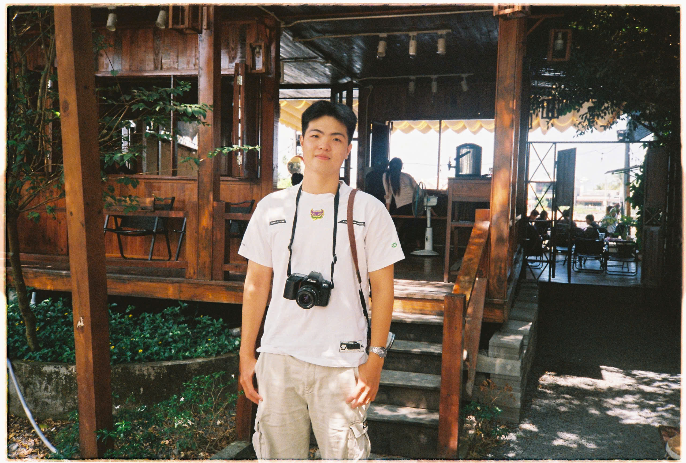

<!-- Palette (Canopy): forest #1A2C04 · lime #A1DB01 · olive #406401 · line #506925 · heading #F4FCE7 · text #C8D8AE -->

  

 

## About

<table>
<tr>
<td width="62%" valign="top">

I'm an **AI Engineering student at HCMUTE** who builds practical AI workflows — from data preparation and model training to evaluation and retrieval-based applications.

- **Now:** GenAI, RAG systems, LLM API integration, Vision-Language Models
- **Strength:** Computer Vision, medical image analysis, model evaluation
- **B.E. IT (AI)** · GPA **3.42/4.0** · graduating **Aug 2027** · open to **AI / GenAI internships**

</td>
<td width="38%" align="center" valign="middle">
  
</td>
</tr>
</table>

## Tech stack

  

## Featured projects

<table>
<tr>
<td width="50%" valign="top">

### [ViDrugLens](https://github.com/FlynnBui399/vidruglens-ocr-vlm)
OCR + **Qwen2.5-VL** extraction and **Qdrant RAG** for grounded answers on Vietnamese drug packages.

</td>
<td width="50%" valign="top">

### [Skin-Lesion Classification](https://github.com/FlynnBui399/skin-lession-classification-using-fusion-ham10000)
Handcrafted features + clinical metadata on **HAM10000**, tuned LightGBM.

**0.946** ROC-AUC · **0.807** accuracy

</td>
</tr>
<tr>
<td width="50%" valign="top">

### [Retinal Vessel Segmentation](https://github.com/FlynnBui399/DL-Research-Segmentation)
**UNet++** with an **EfficientNet-B4** encoder on the HRF dataset.

**0.964** accuracy · **0.771** Dice

</td>
<td width="50%" valign="top">

### [ViGoEmotions](https://github.com/FlynnBui399/vietnamese-emoji-emotion-recognition)
**ViSoBERT + Emoji2Vec** fusion, extending an EACL 2026 paper.

**28** emotion labels · Vietnamese social-media text

</td>
</tr>
</table>

## GitHub stats

<!-- Built by .github/workflows/MAIN.yml and published to the `output` branch -->

  

<picture>
  <source media="(prefers-color-scheme: dark)" srcset="https://raw.githubusercontent.com/FlynnBui399/FlynnBui399/output/github-snake-dark.svg"/>
  <source media="(prefers-color-scheme: light)" srcset="https://raw.githubusercontent.com/FlynnBui399/FlynnBui399/output/github-snake.svg"/>
  
</picture>

